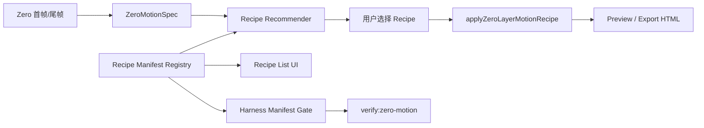

# Zero Native Recipe Manifest Implementation Plan

> **For agentic workers:** REQUIRED SUB-SKILL: Use superpowers:subagent-driven-development (recommended) or superpowers:executing-plans to implement this plan task-by-task. Steps use checkbox (`- [ ]`) syntax for tracking.

**Goal:** 将 Motion Copilot 的 Zero 原生 recipe 从“代码里散落的动效列表 + 推荐规则”升级为 typed recipe manifest registry，让动效方案可解释、可推荐、可验证、可扩展。

**Architecture:** Manifest 使用 TypeScript 文件承载，不引入 YAML/JSON parser 和新构建链路。第一阶段只把 recipe 元信息、适用场景、安全约束、移动端验证清单、表达策略绑定沉淀为 source of truth；`applyZeroLayerMotionRecipe` 的实际执行逻辑保持稳定，后续再让执行层消费更多 manifest 字段。

**Tech Stack:** pnpm monorepo, React 19, TypeScript 5.8, Vite, Vitest, Motion Copilot independent product line on port 5177.

---

## Scope

Build:

- Zero 原生 recipe manifest schema。
- 16 个现有 Zero 原生 recipe 的 manifest registry。
- 从 manifest 派生现有 `zeroLayerMotionRecipes` 列表，避免 UI 和推荐器继续维护重复元信息。
- 推荐器读取 manifest 的 `sceneTypes / capabilities / bestFor / avoidWhen / restraint / mobileGuidance`。
- UI 在“智能推荐”和 recipe 卡片里展示更可解释的信息。
- Harness 增加 manifest gate，保证每个 recipe 有安全策略、移动端验证说明、表达策略绑定，并且 registry 与实际 recipe 列表一致。

Do not build:

- 不让 LLM 生成动画代码。
- 不接入新的在线服务。
- 不引入 YAML/JSON manifest 解析依赖。
- 不改 `apps/web`、`apps/motion-lens` 或它们的端口/构建入口。
- 不重写 Zero 原生执行引擎，不改变尾帧锁定和 corridor 安全原则。

## Hard Rules

- 最终尾帧必须严格复原 Zero 尾帧。
- 动效过程中不能越出 Zero 首尾帧 corridor。
- LLM 只允许参与意图解释或候选排序，不能直接写运行时代码。
- Manifest 首期用 TS 类型保障完整性，内容运营化再考虑外置 JSON/YAML。
- 每个阶段都必须可独立合并；Phase N 完成后系统仍可用。

## File Structure

- Create: `packages/motion-copilot-core/src/zeroLayerMorph/zeroLayerRecipeManifests.ts`
  - 负责 manifest type、registry、索引 helper、manifest validation。
- Modify: `packages/motion-copilot-core/src/zeroLayerMorph/zeroLayerMotionRecipes.ts`
  - 保留 recipe apply 逻辑；`zeroLayerMotionRecipes` 改为由 manifest 投影生成。
- Modify: `packages/motion-copilot-core/src/zeroLayerMorph/zeroLayerRecipeRecommender.ts`
  - 删除本地 `capabilities` 常量，改用 manifest scoring。
- Modify: `packages/motion-copilot-core/src/zeroLayerMorph/createZeroLayerRecipeSampleReport.ts`
  - 接入 manifest gate 和 manifest-derived explanation。
- Modify: `packages/motion-copilot-core/src/index.ts`
  - 导出 manifest registry 和相关类型。
- Modify: `apps/motion-copilot/src/features/zeroLayerMorph/ZeroLayerMorphPanel.tsx`
  - 推荐卡片显示 manifest 信息，选中态按用户实际选择显示。
- Modify: `apps/motion-copilot/src/styles.css`
  - 补充 recipe 说明区样式，保持 13px 字体体系。
- Modify/Test: `packages/motion-copilot-core/test/zeroLayerMorph.test.ts`
  - 增加 registry 完整性、推荐排序、harness gate 测试。
- Modify/Test: `apps/motion-copilot/src/App.test.tsx`
  - 增加 UI 展示和选中态测试。

## Manifest Schema

Implement this shape in `zeroLayerRecipeManifests.ts`:

```ts
import type { ZeroMotionSceneType } from "./zeroMotionSpec";
import type { ZeroLayerExpressionStrategyId } from "./zeroLayerExpressionStrategies";
import type { ZeroLayerMotionRecipeCategory, ZeroLayerMotionRecipeId } from "./zeroLayerMotionRecipes";

export type ZeroLayerRecipeIntent =
  | "state-transition"
  | "continuity"
  | "reveal"
  | "attention"
  | "navigation"
  | "feedback";

export type ZeroLayerRecipeTarget =
  | "container"
  | "text"
  | "list"
  | "tab"
  | "sheet"
  | "popover"
  | "card"
  | "status"
  | "mixed";

export type ZeroLayerRecipeManifest = {
  id: ZeroLayerMotionRecipeId;
  label: string;
  summary: string;
  category: ZeroLayerMotionRecipeCategory;
  sceneTypes: ZeroMotionSceneType[];
  targets: ZeroLayerRecipeTarget[];
  intent: ZeroLayerRecipeIntent;
  bestFor: string[];
  avoidWhen: string[];
  restraint: {
    maxPerView: number;
    intensity: "subtle" | "balanced" | "strong";
    notes: string;
  };
  expressionStrategies: ZeroLayerExpressionStrategyId[];
  capabilities: {
    handlesEnterExit: boolean;
    handlesReorder: boolean;
    handlesSubtleMotion: boolean;
    requiresMatchedGeometry: boolean;
    safeFallback: boolean;
  };
  safety: {
    tailLock: true;
    corridorPolicy: "strict";
    reducedMotion: "crossfade" | "shorten" | "none";
  };
  mobileGuidance: {
    expectedFeel: string;
    inspectionChecklist: string[];
  };
};
```

Add helper API:

```ts
export const zeroLayerRecipeManifests = [
  // all 16 recipe manifests
] satisfies readonly ZeroLayerRecipeManifest[];

export function getZeroLayerRecipeManifest(id: ZeroLayerMotionRecipeId): ZeroLayerRecipeManifest | undefined;

export function requireZeroLayerRecipeManifest(id: ZeroLayerMotionRecipeId): ZeroLayerRecipeManifest;

export function validateZeroLayerRecipeManifestRegistry(): Array<{
  code:
    | "MANIFEST_RECIPE_COUNT_MISMATCH"
    | "MANIFEST_RECIPE_ID_DUPLICATE"
    | "MANIFEST_EXPRESSION_STRATEGY_UNKNOWN"
    | "MANIFEST_SAFETY_POLICY_INVALID"
    | "MANIFEST_MOBILE_GUIDANCE_MISSING";
  severity: "warning" | "error";
  recipeId?: ZeroLayerMotionRecipeId;
  message: string;
}>;
```

## Initial Manifest Matrix

Use these bindings for the first implementation. Keep copy concise in UI; the manifest can carry richer guidance for diagnostics.

| Recipe | Scene Types | Targets | Intent | Expression Strategies | Capability Notes |
|---|---|---|---|---|---|
| `smooth-morph` | `unknown`, `complex-state-change` | `mixed` | `state-transition` | `linear-morph` | safe fallback, subtle motion |
| `spring-expand` | `horizontal-expand`, `vertical-expand`, `card-enter` | `container`, `card` | `continuity` | `spring-settle-contained`, `axis-expand-contained` | enter/exit capable, balanced |
| `status-switch` | `tab-switch`, `complex-state-change` | `status`, `text` | `feedback` | `status-snap-replace`, `content-cross-replace` | subtle, content replacement |
| `container-first` | `horizontal-expand`, `vertical-expand`, `card-enter`, `modal-enter` | `container`, `card`, `mixed` | `continuity` | `staged-container`, `delayed-follow` | enter/exit capable |
| `content-stagger` | `horizontal-expand`, `vertical-expand`, `list-reorder`, `tab-switch` | `text`, `list`, `mixed` | `reveal` | `delayed-follow`, `content-cross-replace` | subtle, multi-content |
| `mask-reveal` | `vertical-expand`, `card-enter`, `modal-enter` | `container`, `popover`, `card` | `reveal` | `mask-scan-reveal`, `clip-reveal-y` | enter/exit capable |
| `dropdown-reveal` | `modal-enter`, `vertical-expand` | `popover`, `list`, `container` | `reveal` | `dropdown-accordion-y`, `clip-reveal-y` | dropdown-specific |
| `anchored-popover` | `modal-enter`, `card-enter` | `popover`, `container` | `reveal` | `anchor-pop-contained`, `spring-settle-contained` | anchor relation |
| `focus-guide` | `tab-switch`, `complex-state-change` | `tab`, `status`, `mixed` | `navigation` | `focus-shift-contained`, `indicator-slide` | subtle focus motion |
| `axis-expand` | `horizontal-expand`, `vertical-expand` | `container`, `card`, `mixed` | `continuity` | `axis-expand-contained`, `clip-reveal-x`, `clip-reveal-y` | axis-aware |
| `list-reorder` | `list-reorder` | `list` | `continuity` | `list-reorder-cascade` | reorder capable |
| `tab-indicator-slide` | `tab-switch`, `horizontal-expand` | `tab`, `status` | `navigation` | `indicator-slide`, `focus-shift-contained` | subtle indicator motion |
| `card-expand-reveal` | `card-enter`, `vertical-expand`, `horizontal-expand` | `card`, `container` | `reveal` | `clip-reveal-x`, `clip-reveal-y`, `staged-container` | enter/exit capable |
| `list-insert-push` | `list-reorder`, `vertical-expand` | `list` | `continuity` | `list-push-insert`, `list-reorder-cascade` | reorder + enter/exit |
| `bottom-sheet-rise` | `modal-enter`, `vertical-expand` | `sheet`, `container` | `reveal` | `sheet-rise-contained`, `delayed-follow` | bottom sheet specific |
| `content-replace` | `tab-switch`, `complex-state-change` | `text`, `status`, `mixed` | `state-transition` | `content-cross-replace`, `status-snap-replace` | text/content changes |

## Data Flow



The manifest explains and constrains recipe choice; it does not replace deterministic motion execution.

---

## Task 1: Add Typed Manifest Registry

**Files:**

- Create: `packages/motion-copilot-core/src/zeroLayerMorph/zeroLayerRecipeManifests.ts`
- Modify: `packages/motion-copilot-core/src/index.ts`
- Test: `packages/motion-copilot-core/test/zeroLayerMorph.test.ts`

- [ ] **Step 1: Write failing registry tests**

Add tests near existing recipe tests:

```ts
import {
  getZeroLayerRecipeManifest,
  validateZeroLayerRecipeManifestRegistry,
  zeroLayerRecipeManifests
} from "../src/zeroLayerMorph/zeroLayerRecipeManifests";
import { zeroLayerExpressionStrategies, zeroLayerMotionRecipes } from "../src";

it("keeps Zero native recipe manifests complete and safe", () => {
  expect(zeroLayerRecipeManifests.map((manifest) => manifest.id)).toEqual(
    zeroLayerMotionRecipes.map((recipe) => recipe.id)
  );
  expect(validateZeroLayerRecipeManifestRegistry()).toEqual([]);
});

it("binds each Zero native recipe manifest to known expression strategies", () => {
  const strategyIds = new Set(zeroLayerExpressionStrategies.map((strategy) => strategy.id));
  for (const manifest of zeroLayerRecipeManifests) {
    expect(manifest.expressionStrategies.length).toBeGreaterThan(0);
    for (const strategyId of manifest.expressionStrategies) {
      expect(strategyIds.has(strategyId)).toBe(true);
    }
  }
});

it("exposes a lookup helper for Zero native recipe manifests", () => {
  expect(getZeroLayerRecipeManifest("dropdown-reveal")?.mobileGuidance.expectedFeel).toContain("下拉");
});
```

- [ ] **Step 2: Run test to verify it fails**

Run:

```bash
pnpm --filter @motion-copilot/core test -- test/zeroLayerMorph.test.ts -t "recipe manifests"
```

Expected: FAIL because `zeroLayerRecipeManifests.ts` does not exist.

- [ ] **Step 3: Create `zeroLayerRecipeManifests.ts`**

Implement the schema above and all 16 manifests from the Initial Manifest Matrix. Each manifest must include:

- 2-4 `bestFor` strings written for product users.
- 1-3 `avoidWhen` strings.
- `restraint.maxPerView` set to `1` for strong recipes and `2` for subtle recipes.
- `safety.tailLock: true`.
- `safety.corridorPolicy: "strict"`.
- `mobileGuidance.inspectionChecklist` with at least 2 concrete checks.

- [ ] **Step 4: Export manifest API**

Add to `packages/motion-copilot-core/src/index.ts`:

```ts
export * from "./zeroLayerMorph/zeroLayerRecipeManifests";
```

- [ ] **Step 5: Run registry tests**

Run:

```bash
pnpm --filter @motion-copilot/core test -- test/zeroLayerMorph.test.ts -t "recipe manifests"
```

Expected: PASS.

---

## Task 2: Derive Legacy Recipe List From Manifest

**Files:**

- Modify: `packages/motion-copilot-core/src/zeroLayerMorph/zeroLayerMotionRecipes.ts`
- Test: `packages/motion-copilot-core/test/zeroLayerMorph.test.ts`

- [ ] **Step 1: Keep failing compatibility test**

Ensure this existing behavior remains:

```ts
expect(zeroLayerMotionRecipes.map((recipe) => recipe.id)).toEqual([
  "smooth-morph",
  "spring-expand",
  "status-switch",
  "container-first",
  "content-stagger",
  "mask-reveal",
  "dropdown-reveal",
  "anchored-popover",
  "focus-guide",
  "axis-expand",
  "list-reorder",
  "tab-indicator-slide",
  "card-expand-reveal",
  "list-insert-push",
  "bottom-sheet-rise",
  "content-replace"
]);
```

- [ ] **Step 2: Replace inline metadata array**

In `zeroLayerMotionRecipes.ts`, replace the hardcoded `zeroLayerMotionRecipes` array with:

```ts
import { zeroLayerRecipeManifests } from "./zeroLayerRecipeManifests";

export const zeroLayerMotionRecipes: ZeroLayerMotionRecipe[] = zeroLayerRecipeManifests.map(
  ({ id, label, summary, category }) => ({ id, label, summary, category })
);
```

Do not touch `applyZeroLayerMotionRecipe` in this task.

- [ ] **Step 3: Run compatibility tests**

Run:

```bash
pnpm --filter @motion-copilot/core test -- test/zeroLayerMorph.test.ts -t "Zero native motion recipes"
pnpm --filter @motion-copilot/core typecheck
```

Expected: PASS.

---

## Task 3: Make Recommendation Manifest-Driven

**Files:**

- Modify: `packages/motion-copilot-core/src/zeroLayerMorph/zeroLayerRecipeRecommender.ts`
- Test: `packages/motion-copilot-core/test/zeroLayerMorph.test.ts`

- [ ] **Step 1: Extend recommendation test coverage**

Add assertions that recommendation reasons include manifest-derived guidance:

```ts
const recommendation = recommendZeroLayerRecipes(spec, { limit: 5 });
expect(recommendation.candidates[0]?.reasons.join(" ")).toContain("适合");
expect(recommendation.candidates[0]?.warnings).toEqual(expect.any(Array));
```

Keep existing order tests for dropdown, horizontal expansion, list reorder, tab switch, and card expansion. These are regression gates; do not loosen them unless the UI/product behavior is intentionally changed.

- [ ] **Step 2: Remove local capability duplication**

Delete the local `capabilities` constant and derive candidate scoring input from `zeroLayerRecipeManifests`.

Recommended implementation shape:

```ts
for (const manifest of zeroLayerRecipeManifests) {
  const baseScore = manifest.sceneTypes.includes(spec.scene.type) ? 62 : 30;
  const capability = manifest.capabilities;
  // preserve existing hard scoring rules, but read booleans from manifest
}
```

- [ ] **Step 3: Add manifest reasons and avoid warnings**

When a manifest scene type matches, add:

```ts
reasons.push(`适合${spec.scene.type}场景：${manifest.bestFor[0]}`);
```

When a recipe is not the top fit or a risk exists, expose `avoidWhen` as warnings, capped at 2 items:

```ts
warnings.push(...manifest.avoidWhen.slice(0, 2));
```

- [ ] **Step 4: Preserve selected recipe stability**

Run existing recommendation tests and confirm these still hold unless product intentionally changes:

- dropdown scene selects `dropdown-reveal`
- horizontal expansion prefers `container-first` / `axis-expand` family
- list reorder selects `list-insert-push`
- tab scene includes `tab-indicator-slide`
- low-confidence complex scene can fall back to `smooth-morph`

- [ ] **Step 5: Run recommender tests**

Run:

```bash
pnpm --filter @motion-copilot/core test -- test/zeroLayerMorph.test.ts -t "recommend"
pnpm --filter @motion-copilot/core typecheck
```

Expected: PASS.

---

## Task 4: Surface Manifest Guidance In UI

**Files:**

- Modify: `apps/motion-copilot/src/features/zeroLayerMorph/ZeroLayerMorphPanel.tsx`
- Modify: `apps/motion-copilot/src/styles.css`
- Test: `apps/motion-copilot/src/App.test.tsx`

- [ ] **Step 1: Add UI test for selected recipe state**

Add or update a test so clicking a non-first recipe card gives that card selected state and removes selected state from the previous card.

Expected UI behavior:

- Recommended recipe can show “推荐”.
- User-selected recipe shows “已选择”.
- The first recommendation is not permanently selected after the user chooses another recipe.

- [ ] **Step 2: Add UI test for manifest content**

Assert that the smart recommendation section can render:

- `适合`
- `不建议`
- `真机看点`

- [ ] **Step 3: Import manifest lookup**

In `ZeroLayerMorphPanel.tsx`, import:

```ts
import { getZeroLayerRecipeManifest } from "@motion-copilot/core";
```

For each candidate, lookup the manifest and render:

- label and summary
- top 1-2 reasons
- top 1 avoid warning
- `mobileGuidance.expectedFeel`
- expression strategy labels if space allows

- [ ] **Step 4: Keep diagnostics secondary**

Keep harness diagnostics in `<details>` and default collapsed unless there is an error severity. The user should not need to read diagnostics to choose a recipe.

- [ ] **Step 5: Style the recipe explanation compactly**

CSS constraints:

- 13px text.
- No nested card inside card.
- Use compact chips for “推荐 / 已选择 / 强表现 / 稳妥” status.
- Avoid large blocks of diagnostic text in the right panel.

- [ ] **Step 6: Run app tests**

Run:

```bash
pnpm --filter @motion-copilot/app test -- -t "Zero|智能推荐|recipe"
pnpm --filter @motion-copilot/app typecheck
```

Expected: PASS.

---

## Task 5: Add Manifest Gates To Harness

**Files:**

- Modify: `packages/motion-copilot-core/src/zeroLayerMorph/createZeroLayerRecipeSampleReport.ts`
- Test: `packages/motion-copilot-core/test/zeroLayerMorph.test.ts`

- [ ] **Step 1: Add risk codes**

Extend `ZeroLayerRecipeSampleRiskCode` with:

```ts
| "RECIPE_MANIFEST_INVALID"
| "RECIPE_MANIFEST_EXPRESSION_MISSING"
| "RECIPE_MANIFEST_SAFETY_MISSING"
```

- [ ] **Step 2: Add manifest validation to sample report**

At report creation, call `validateZeroLayerRecipeManifestRegistry()`. Convert validation failures into sample risks with severity preserved.

- [ ] **Step 3: Add per-recipe strategy check**

For each sampled recipe, ensure its motion signature uses at least one strategy declared by the manifest when matched layers exist. If not, add `RECIPE_MANIFEST_EXPRESSION_MISSING`.

- [ ] **Step 4: Keep tail/corridor gates unchanged**

Do not weaken:

- `TAIL_FRAME_MISMATCH`
- `MATCHED_CORRIDOR_OVERFLOW`
- `RECIPE_DIFF_TOO_SMALL`
- `RECIPE_TOO_FADE_ONLY`

Manifest gates are additional diagnostics, not replacements.

- [ ] **Step 5: Run harness tests and CLI**

Run:

```bash
pnpm --filter @motion-copilot/core test -- test/zeroLayerMorph.test.ts -t "recipe sampling"
pnpm verify:zero-motion
```

Expected:

- PASS.
- No manifest-related errors.
- Existing recipe differentiation checks remain active.

---

## Task 6: Full Verification

**Files:** no new functional files unless earlier tests reveal drift.

- [ ] **Step 1: Run Motion Copilot focused checks**

```bash
pnpm --filter @motion-copilot/core typecheck
pnpm --filter @motion-copilot/core test
pnpm --filter @motion-copilot/app typecheck
pnpm --filter @motion-copilot/app test
pnpm verify:zero-motion
```

- [ ] **Step 2: Run app build**

```bash
pnpm --filter @motion-copilot/app build
```

- [ ] **Step 3: Manual browser acceptance**

Start with the existing Zero MCP env:

```bash
ZERO_MCP_HTTP_URL=http://127.0.0.1:27618/mcp \
ZERO_MCP_LAYER_COMMAND=node \
ZERO_MCP_LAYER_ARGS=/Users/heyunshen/work/PROJECT/jdc/ai-motion/scripts/zero-mcp-layer-bridge.mjs \
ZERO_MCP_VISUAL_COMMAND=node \
ZERO_MCP_VISUAL_ARGS=/Users/heyunshen/work/PROJECT/jdc/ai-motion/scripts/zero-mcp-visual-bridge.mjs \
pnpm motion-copilot:dev
```

Manual checks:

- Open `http://127.0.0.1:5177/`.
- Use “发现文件首尾帧”.
- Select a valid `-首帧` / `-尾帧` pair.
- Confirm smart recommendation cards show “适合 / 不建议 / 真机看点”.
- Click a non-first recipe and confirm selected state follows that card.
- Apply recipe and confirm final frame equals Zero tail frame.
- Download/export HTML and confirm the same recipe guidance does not affect export correctness.

---

## Acceptance Criteria

- `zeroLayerMotionRecipes` no longer duplicates label/category/summary metadata by hand.
- Every Zero native recipe has a manifest with scene, target, intent, safety, restraint, expression strategy, and mobile guidance.
- Recommender reads capabilities from manifest instead of a second hardcoded capability table.
- Smart recommendation UI explains why a recipe is recommended and when not to use it.
- Harness reports manifest quality errors if a recipe is added without required guidance.
- `pnpm verify:zero-motion` passes.
- Tail frame strict restoration and corridor constraints remain unchanged.

## Rollback Plan

This change is low migration risk because it has no persistent data migration.

If regressions appear:

1. Revert `zeroLayerRecipeRecommender.ts` to the previous local capability table.
2. Keep `zeroLayerRecipeManifests.ts` unused temporarily; it is side-effect free.
3. Revert `zeroLayerMotionRecipes.ts` projection if the import creates a cycle.
4. Run `pnpm --filter @motion-copilot/core test` and `pnpm --filter @motion-copilot/app test`.

## Risk Notes

- Main risk: circular import between `zeroLayerMotionRecipes.ts` and `zeroLayerRecipeManifests.ts`.
  - Mitigation: manifest imports only recipe types with `import type`; recipe file imports manifest values.
- Main product risk: richer manifest text bloats the right panel.
  - Mitigation: UI shows only top-line guidance; diagnostics remain collapsed.
- Main behavior risk: recommendation order changes unexpectedly.
  - Mitigation: preserve existing recommendation tests before refactor, then migrate scorer.

## Final Todo List

- [ ] Create typed Zero recipe manifest registry.
- [ ] Add manifest completeness and safety tests.
- [ ] Export manifest API from core package.
- [ ] Derive `zeroLayerMotionRecipes` from manifest.
- [ ] Replace recommender local capabilities with manifest capabilities.
- [ ] Preserve existing recommendation order tests.
- [ ] Add manifest-derived recommendation reasons and warnings.
- [ ] Show recipe guidance in Zero 原生 UI cards.
- [ ] Fix recipe selected state so user-selected recipe is visually selected.
- [ ] Keep harness diagnostics collapsed unless there are errors.
- [ ] Add manifest validation into recipe sample harness.
- [ ] Ensure expression strategies declared by manifest match sampled recipe signatures.
- [ ] Run core typecheck/tests.
- [ ] Run app typecheck/tests.
- [ ] Run `pnpm verify:zero-motion`.
- [ ] Run Motion Copilot app build.
- [ ] Manual test with Zero MCP and a real `-首帧` / `-尾帧` pair.
